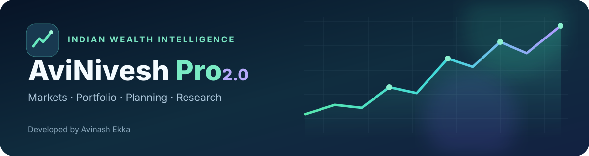
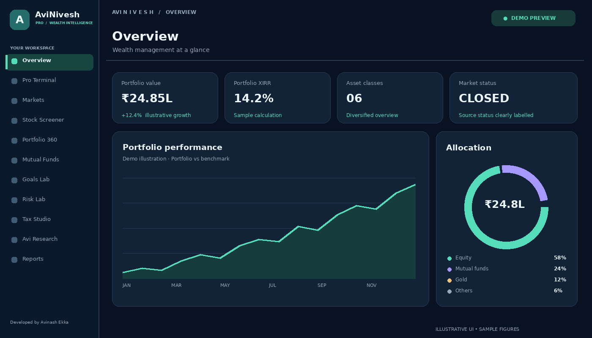
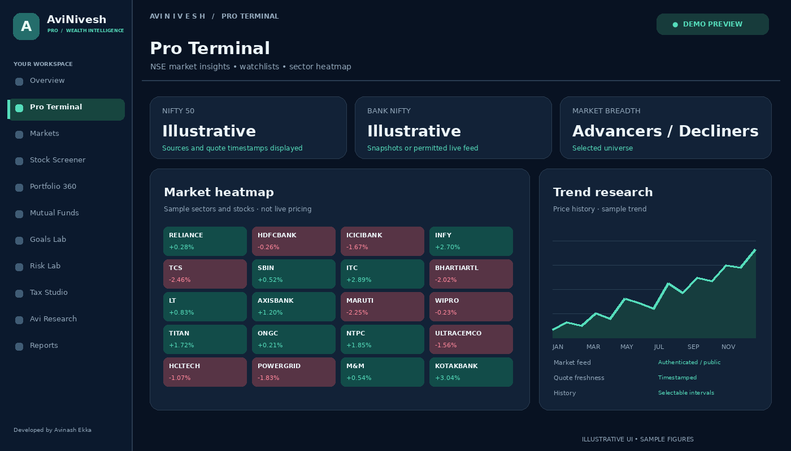
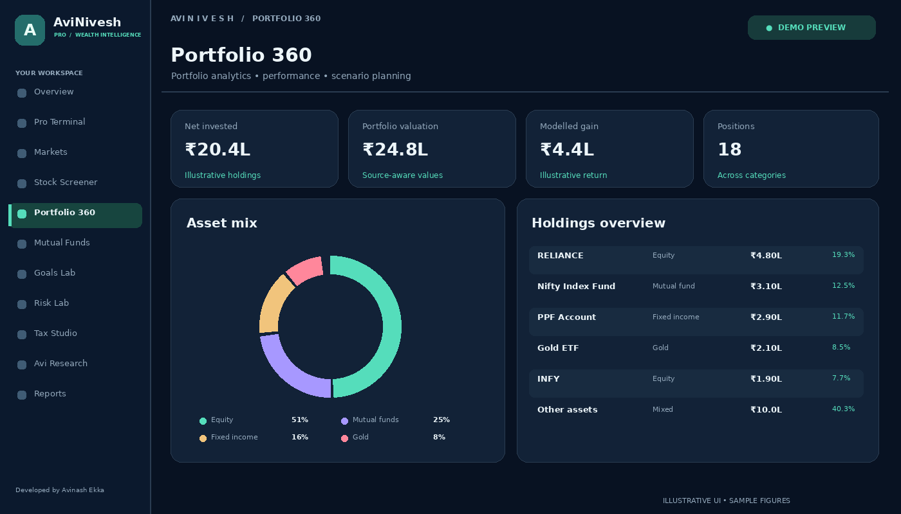
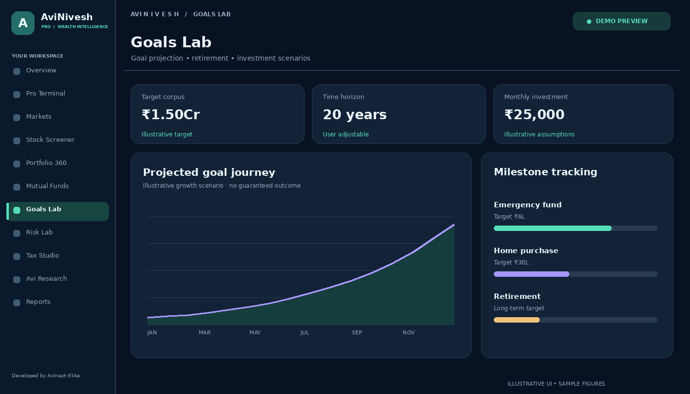

<div align="center">



# AviNivesh Pro 2.0

**Indian market intelligence · Portfolio analytics · Financial planning**

A premium investment research and wealth-planning workspace designed for Indian investors.

**Developed by Avinash Ekka**

</div>

## Explore the app

A unified experience for tracking markets, understanding investments, exploring risk and planning financial goals.

> **Interface gallery:** The visuals below are **illustrative previews based on the application's design** (not live application screenshots). All figures and holdings shown are fictional examples.

### Wealth dashboard



### Market intelligence



### Portfolio 360°



### Financial goals



## Features

| Market research | Portfolio & planning | User experience |
| --- | --- | --- |
| Indian equity watchlists and price history | Multi-asset portfolio tracking | Responsive premium dashboard |
| Market heatmaps and candlestick charts | XIRR, allocation and rebalancing | Dark and light themes |
| Stock screening and company analysis | Mutual fund NAV tracking | Interactive charts and animations |
| Optional authenticated Upstox feed | SIP and retirement calculators | Downloadable financial reports |
| Clearly labelled data sources | Goal modelling and stress scenarios | Educational research assistant |
| Quote and threshold alerts | Configurable tax illustrations | PWA support |

## Get started

Requires **Node.js 20+** and npm.

```bash
npm install
npm run dev
```

Open **http://localhost:5173** in your browser. Windows users can run `start-windows.bat` instead.

For optional market-data and AI integrations, copy `.env.example` to `.env` and configure supported credentials locally. See the [application guide](docs/APP_GUIDE.md).

## Financial data and privacy

AviNivesh Pro supports authenticated market-data integrations where appropriate access is available. Without verified feeds, data may be delayed, unavailable, or clearly marked as **sample data**. The app does not execute trades.

Portfolio details and preferences are generally stored locally in the browser. Financial exports may contain personal information; keep downloaded copies secure. Never add API tokens or personal holdings to your public repository.

## Important notice

AviNivesh Pro is an **educational investment research and planning tool**. It is not a SEBI-registered investment adviser or a trading platform. Calculations, scenarios and projections are illustrative and do not guarantee financial results. Check current market information and consult an appropriately qualified professional before making financial decisions.

---

<div align="center">

**AviNivesh Pro 2.0**  
*Developed by Avinash Ekka*

</div>
